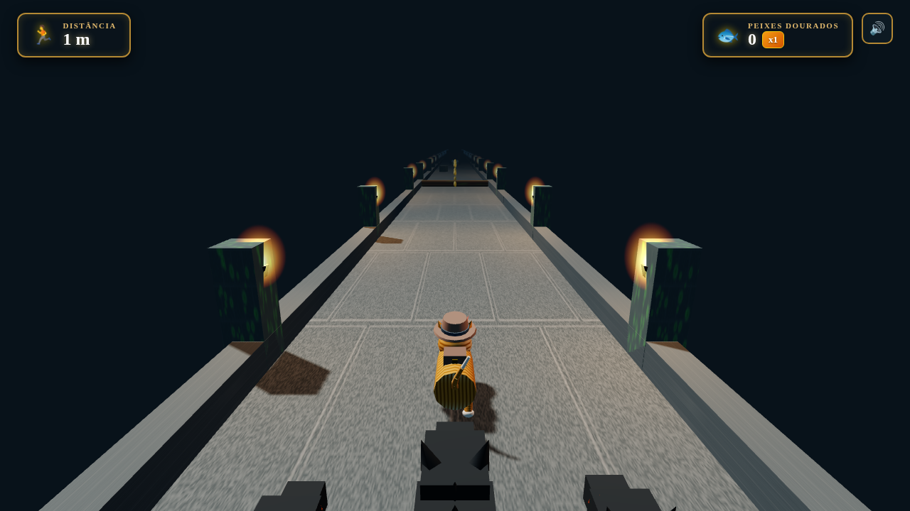

# Gato das Ruínas (Cat Temple Run 3D) 🐾🏛️

Um jogo 3D completo no estilo *Temple Run 1* onde o protagonista é um gato explorador, construído inteiramente com **HTML5, Three.js e Web Audio API** em um arquivo único sem dependências de modelos 3D externos ou arquivos de áudio pré-gravados.

## 🎮 Como Jogar

Basta abrir o arquivo `index.html` em qualquer navegador web moderno (desktop ou mobile).

### Controles no Teclado:
- **`A` / `D`** ou **`Setas Esquerda / Direita`**: Trocar de faixa (Esquerda, Centro, Direita).
- **`W`**, **`Seta Cima`** ou **`Espaço`**: Pular sobre raízes, troncos e buracos.
- **`S`** ou **`Seta Baixo`**: Deslizar (Slide) por baixo de armadilhas de fogo e arcos de pedra.
- **`Ícone de Áudio` (topo direito)**: Ativar/desativar som.

### Controles no Mobile (Touch):
- **Deslizar para Esquerda / Direita**: Troca de faixa.
- **Deslizar para Cima**: Pulo.
- **Deslizar para Baixo**: Deslize (Slide).

---

## ✨ Características do Projeto

### 🐱 Personagem e Guardiões
- **Gato Explorador 3D:** Modelado com primitivas Three.js (`CylinderGeometry`, `SphereGeometry`, `BoxGeometry`, `ConeGeometry`), chapéu fedora de explorador com pena vermelha, mochila de couro com fivela dourada, bigodes e rabo longo sinuoso.
- **Animações Procedurais:** Galope sincronizado das 4 patas, balanço suave da cauda, inclinação dinâmica ao trocar de faixa e pose estendida no salto.
- **Mecânica de Slide:** O gato achata sua escala vertical (`scale.y = 0.45`), abaixa o centro de massa e diminui sua hitbox (`THREE.Box3`) para passar por baixo de armadilhas.
- **Sistema de Tropeço e Perseguição (Stumble):** 3 guardiões caninos da floresta correm logo atrás do gato. Tropeçar em raízes ou raspar nas quinas aproxima os guardiões; dois tropeços seguidos ou uma colisão frontal encerram a partida!

### 🏛️ Ambiente e Pistas Procedurais
- **Passarela Ancestral:** Geração modular infinita suspensa sobre um abismo com neblina atmosférica (`THREE.FogExp2`), pilares de pedra com musgo e tochas com iluminação pontual cintilante (`PointLight`).
- **4 Tipos de Obstáculos:**
  1. *Raízes e Troncos baixos:* Exigem salto.
  2. *Arcos de pedra com armadilha de fogo:* Exigem deslize.
  3. *Buracos no piso / abismo:* Queda mortal caso não salte ou desvie.
  4. *Quinas e estreitamentos:* Causam tropeço ao raspar nas bordas.
- **Colecionáveis e Power-ups:**
  - *Peixes Dourados:* Moedas em formato de peixe 3D dispostas em linha e arcos parabólicos de salto.
  - *Ímã de Catnip (8s):* Atrai todos os peixes próximos suavemente até o gato.
  - *Escudo Ancestral (8s):* Bolha de energia cintilante que estilhaça obstáculos com física de partículas.

### 🎵 Áudio Sintetizado (Web Audio API)
Sem arquivos `.mp3` ou gravações externas. Todos os efeitos sonoros são sintetizados em tempo real:
- Passos de pedra rápidos.
- Efeitos de varredura (*swoosh*) para salto e deslize.
- Carrilhão cristalino de coleta de peixes com progressão de frequência por combo.
- Miado felino procedural realista com filtros formantes vocais.
- Rosnado das bestas sombrias.
- Trilha de tambores tribais ancestrais gerada por osciladores.

---

## 🛠️ Tecnologias Utilizadas
- [Three.js r128](https://cdnjs.cloudflare.com/ajax/libs/three.js/r128/three.min.js)
- HTML5 Canvas para geração de texturas procedurais em memória
- Web Audio API nativa
- CSS3 Glassmorphism

---

## 📄 Licença
Distribuído sob a licença MIT. Sinta-se livre para jogar, modificar e compartilhar!
